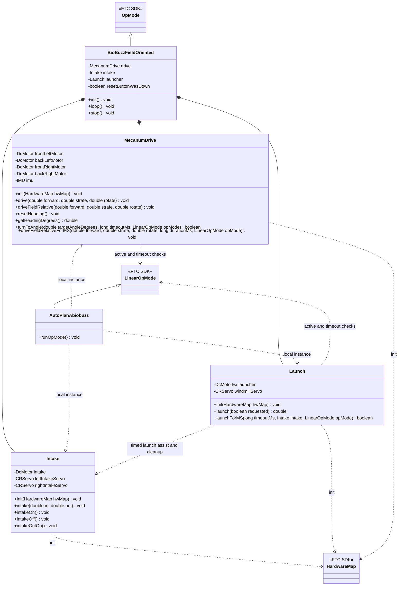
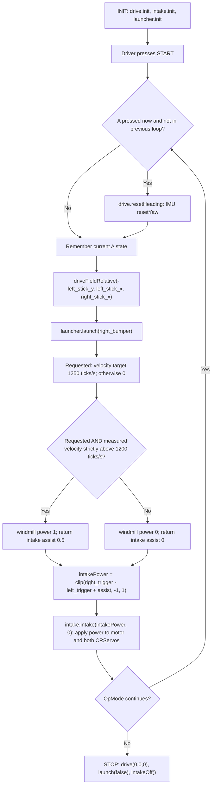
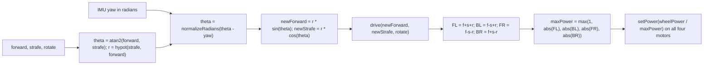
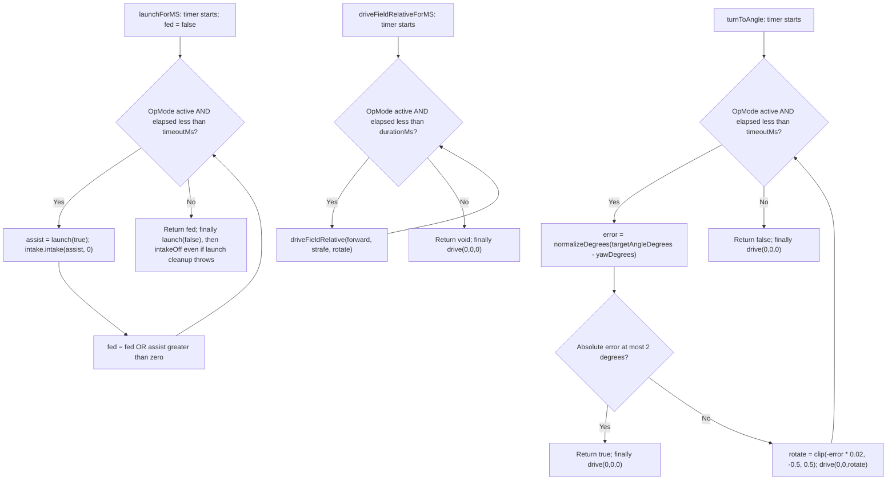

# BIOBUZZ code diagrams and review

These diagrams describe the existing WAM Robotics team 31778 code, reviewed on
2026-11-14 against source commit `12f0f2d`. They describe software commands, not
verified robot motion, successful scoring, or game-rule compliance. No robot
behavior was changed for this review.

GitHub renders the Mermaid diagrams below. In VS Code, use a Markdown preview
that supports Mermaid. The source of each diagram is its fenced `mermaid` block;
update these blocks when the corresponding Java control flow changes.

## Source files

All paths below are relative to this document. The working package is
`org.firstinspires.ftc.teamcode`.

| File | Responsibility |
| --- | --- |
| [BioBuzzFieldOriented.java](../src/main/java/org/firstinspires/ftc/teamcode/BioBuzzFieldOriented.java) | Iterative TeleOp; owns and coordinates the three mechanisms. |
| [Intake.java](../src/main/java/org/firstinspires/ftc/teamcode/mechanisms/Intake.java) | One intake motor and two continuous-rotation intake servos. |
| [Launch.java](../src/main/java/org/firstinspires/ftc/teamcode/mechanisms/Launch.java) | Launcher velocity, feeder gating, and intake-assist request. |
| [MecanumDrive.java](../src/main/java/org/firstinspires/ftc/teamcode/mechanisms/MecanumDrive.java) | Four-wheel power mixing, field-relative transformation, heading, and timed motion. |
| [AutoPlanAbiobuzz.java](../src/main/java/org/firstinspires/ftc/teamcode/AutoPlanAbiobuzz.java) | Related caller of the mechanisms' timed autonomous helpers. |

## 1. Class relationships

Solid composition arrows mean the TeleOp owns its mechanism instances. Dotted
arrows mean a class uses another class or SDK service. The methods shown are the
public methods declared by the four reviewed team classes.



In TeleOp, `Launch` does **not** directly drive `Intake`. It returns an assist
power to `BioBuzzFieldOriented`, which combines it with the driver's triggers.
Only `launchForMS` directly commands the supplied `Intake` instance.

## 2. TeleOp lifecycle and each control-loop iteration

The SDK invokes `init()`, repeatedly invokes `loop()` after Start, and invokes
`stop()` when the OpMode ends. The diagram shows normal execution without an
exception.



### Driver controls

| Gamepad 1 input | Software command |
| --- | --- |
| Left stick Y, negated | Field-relative forward/backward. |
| Left stick X | Field-relative strafe. Positive strafe is documented as right. |
| Right stick X | Rotation. Positive rotation is documented as clockwise. |
| A, rising edge | Reset IMU yaw once per press, redefining field-relative zero. |
| Right trigger | Positive intake command. |
| Left trigger | Negative intake command. |
| Right bumper, held | Request launcher spin-up and velocity-gated feeding. |

The trigger and assist commands are added before clipping. With neither trigger
pressed, feeding produces intake power `0.5`. With right trigger `1`, feeding
clips `1.5` to `1`. With left trigger `1`, feeding produces `-0.5`: the intake
reverses while the windmill feeder remains on. Equal trigger values cancel each
other but do not cancel launcher assist.

## 3. Field-relative drive and wheel mixing



In the wheel-mixing node, `f`, `s`, and `r` mean the robot-relative forward,
strafe, and rotation commands; `r` there is not the polar radius. Rotation is
not transformed by yaw. Normalization scales all four powers by the same factor
and preserves their ratios.

At yaw zero, the translation transform preserves forward/strafe. At yaw
`+pi/2`, field command `(forward=1, strafe=0)` becomes approximately
`(newForward=0, newStrafe=1)`. These are mathematical results; physical direction
depends on correct wiring, wheel placement, motor direction, and IMU mounting.

### Hardware map and initialization

| Owner | Configuration names and types | Explicit configuration in `init()` |
| --- | --- | --- |
| `MecanumDrive` | `left_front_drive`, `left_back_drive`, `right_front_drive`, `right_back_drive`: `DcMotor` | Left motors REVERSE; right motors FORWARD; all RUN_USING_ENCODER and BRAKE. |
| `MecanumDrive` | `imu`: `IMU` | REV logo LEFT, USB DOWN. Yaw is not explicitly reset in this method. |
| `Intake` | `intake`: `DcMotor` | BRAKE. This method does not explicitly set motor direction, run mode, or initial motor power. |
| `Intake` | `left_intake_servo`, `right_intake_servo`: `CRServo` | Right servo REVERSE; both servo powers zero. Left direction is not explicitly set here. |
| `Launch` | `launcher`: `DcMotorEx` | RUN_USING_ENCODER; PIDF `(40, 0, 0, 12.5)`; `launch(false)` sets velocity target zero. |
| `Launch` | `windmillServo`: `CRServo` | REVERSE; `launch(false)` sets power zero. |

Hardware-map names are case-sensitive configuration contracts, not inferred
physical port numbers. Verify the mounting and motor-specific encoder units
before interpreting the constants as physical speed. No RPM conversion is
needed for the existing `setVelocity(double)` call.

`Intake.intake(in, out)` applies `in - out` to all three devices without its own
range validation. The TeleOp clips its combined input first. `intakeOn`,
`intakeOff`, and `intakeOutOn` directly command `+1`, `0`, and `-1`; they do not
update the `intakePower` field, which is not read by the reviewed callers.

## 4. Timed autonomous helpers

These helpers block their caller until completion or cancellation. Each loop
checks `opModeIsActive()` and elapsed time. The cleanup shown runs in `finally`,
including when a loop operation throws; actuator cleanup itself can still throw.



- `launchForMS` includes spin-up in its timeout. `true` means feeding was enabled
  at least once, not that a game element was detected or scored. It can return
  `true` even if Stop is pressed after feeding began.
- `turnToAngle` uses absolute yaw relative to the current IMU zero, not a relative
  turn amount. Its rotation sign accounts for positive drive rotation being
  opposite positive IMU yaw.
- `driveFieldRelativeForMS` is time-based open-loop travel, not encoder-distance
  or pose feedback. It has no success/cancellation return value.
- Nonpositive durations skip the loops and still perform cleanup. No helper
  validates an input deadline or calibrates a physical distance.

The related autonomous caller initializes these mechanisms, waits for Start,
records its starting yaw, requests a launch for `5000 ms`, and drives a series of
`1000 ms` field-relative diagonals at axis powers `0.25`. It runs the intake on
the second leg and for an additional `1000 ms` pause, then drives a third leg and
tries to return to the recorded heading with a `2000 ms` timeout. It does not
call `resetHeading()`, so its translation axes use the current IMU reference.

## Review findings and verification questions

### Confirmed caller integration finding

**P2 - Autonomous discards launch/turn outcomes.**
[AutoPlanAbiobuzz.runOpMode](../src/main/java/org/firstinspires/ftc/teamcode/AutoPlanAbiobuzz.java)
ignores the boolean from `Launch.launchForMS` and `MecanumDrive.turnToAngle`.
If the launcher never exceeds the feed threshold, `launchForMS` returns `false`
but the autonomous continues driving while active without reporting the failed
feed. If the turn times out outside tolerance, the OpMode ends without reporting
the failed heading correction. A future behavior change should explicitly
choose whether to abort or continue and surface the result through telemetry.
This review does not change that policy.

### Questions to resolve before changing behavior

- **Reverse intake versus launch:** the `-0.5` intake command with full left
  trigger and active feeding is definite software behavior, but whether it is
  a bug depends on the intended driver priority. Decide whether reverse intake
  should inhibit feeding before adding an interlock.
- **Field reference:** confirm that the driver resets heading while facing the
  intended field-forward direction, and establish the autonomous starting IMU
  reference. Do not assume `init()` defines a fresh field heading.
- **Calibration:** verify logo LEFT/USB DOWN, motor directions, launcher encoder
  units, PIDF values, and the `1250/1200` velocity targets on the actual robot.
- **Observability:** the reviewed TeleOp has no explicit team telemetry for yaw,
  velocity, feeding state, or intake power. Adding those would make supervised
  debugging easier; their absence is not a compilation failure.
- **Exceptional shutdown:** TeleOp `stop()` calls the three mechanism stops
  sequentially without `finally`. If an earlier stop call throws, later calls
  are not reached. The timed launch helper already uses nested `finally` to
  attempt intake cleanup even if launcher cleanup throws. This is a robustness
  gap, not evidence that normal SDK Stop handling failed on hardware.

No Java compilation errors were found. The rising-edge heading reset,
velocity-gated feeder, TeleOp intake clipping, wheel normalization, and timed
helper cleanup are represented directly from the source. This is a static code
review and build check, not a robot test.

## Build setup and validation

The existing environment already has Eclipse Temurin **JDK 17**. Gradle runs on
Java 17; the robot project's Java source/bytecode compatibility remains **Java 8**
in `build.common.gradle`. Do not change source compatibility or upgrade the FTC
SDK just to use JDK 17.

For a Windows machine without JDK 17, install it with:

```powershell
winget install --id EclipseAdoptium.Temurin.17.JDK --exact
```

Open a new terminal after installation and verify `JAVA_HOME`, `java -version`,
and `javac -version`. Use a compatible Android SDK with the required packages.
Set `ANDROID_HOME` to its local root or configure an ignored `local.properties`;
do not commit machine-specific SDK paths.

From the repository root, using a conventional per-user Android SDK location:

```powershell
$env:ANDROID_HOME = Join-Path $env:LOCALAPPDATA 'Android\Sdk'
.\gradlew.bat --version
.\gradlew.bat :TeamCode:compileDebugJavaWithJavac --console=plain --no-daemon
.\gradlew.bat :TeamCode:assembleDebug --console=plain --no-daemon
git diff --check
```

During the compile check, Gradle installed missing Android SDK Platform 30 and
Build-Tools 35.0.0 using the SDK's already-accepted licenses. Build output,
Gradle caches, and SDK configuration stay outside version control. No robot
software was installed or started.

Validation on 2026-11-14:

- Java and `javac`: Temurin `17.0.21`.
- `:TeamCode:compileDebugJavaWithJavac`: passed.
- `:TeamCode:assembleDebug`: passed.
- All four diagrams: parsed successfully with Mermaid.
- Documentation links and `git diff --check`: passed.
- Existing build warnings: deprecated SDK/Gradle APIs and native libraries
  packaged without debug-symbol stripping. These did not fail the build.

This documentation-only change leaves the existing FTC SDK/app version
unchanged.
